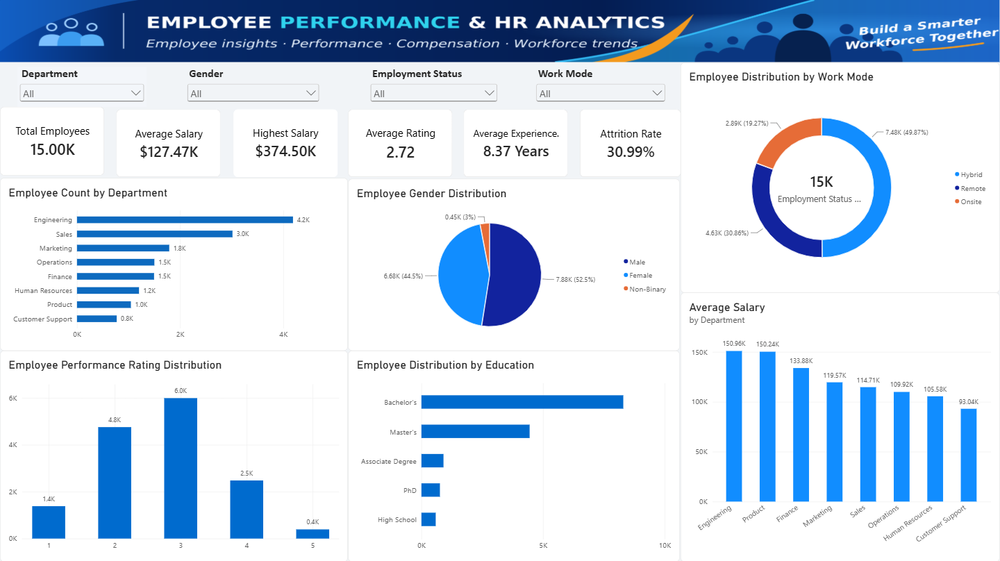

# 📊 Employee Performance & HR Analytics

## 📌 Project Overview
This project analyzes employee data to understand workforce distribution, employee performance, salary patterns, and attrition trends. The objective is to generate meaningful HR insights that can support better workforce planning, employee retention, and decision-making.

**Dataset:** Synthetic Enterprise HR Analytics Dataset  
**Records:** 15,000 employees  
**Columns:** 33

## 🛠️ Tools & Technologies
- **Python:** Data cleaning, preprocessing and Exploratory Data Analysis (EDA)
- **Pandas:** Data manipulation and analysis
- **Matplotlib & Seaborn:** Data visualization
- **MySQL:** Data storage and SQL analysis
- **Power BI:** Interactive dashboard and KPI visualization

## 🔄 Project Workflow

### 1. 🐍 Python – Data Cleaning & EDA
- Loaded and explored the HR dataset.
- Checked and removed duplicate records.
- Cleaned text columns.
- Converted date columns into appropriate date formats.
- Analyzed employee demographics, salary, experience, performance and attrition.
- Generated visualizations to identify trends and patterns.
- Exported the cleaned dataset.

### 2. 🗄️ SQL – Data Analysis
Performed SQL analysis using MySQL, including:
- Employee count by department.
- Average salary by department.
- Top 10 highest-paid employees.
- Average experience by department.
- Employees with the highest performance ratings.
- Employee distribution by work mode.
- Attrition analysis by department.
- Salary ranking within departments using window functions.
- Employees earning above the average salary.
- Gender distribution and percentages.

### 3. 📈 Power BI – Interactive Dashboard
Developed an interactive HR analytics dashboard featuring:

**Key Performance Indicators (KPIs)**
- Total Employees
- Average Salary
- Highest Salary
- Average Experience
- Average Performance Rating
- Attrition Rate

**Analysis**
- Employee distribution by department.
- Gender distribution.
- Work mode distribution.
- Employee performance rating distribution.
- Education distribution.
- Average salary by department.
- Attrition analysis.

**Interactive Filters**
- Department
- Gender
- Employment Status
- Work Mode

### 4. 📄 PDF Report
Generated a PDF report summarizing the dataset and key analytical findings.

## 💡 Key Insights
- Total workforce consists of 15,000 employees.
- Overall attrition rate is 30.99%.
- Average employee salary is 127,472.13.
- Average employee experience is 8.37 years.
- Average performance rating is 2.72 out of 5.
- Engineering has the highest number of employee exits (1,268).
- Marketing has the highest department attrition rate (32.33%).
- Experience and salary have a strong positive correlation of 0.823.

## 📁 Project Structure

```text
HR_Analytics/
│
├── Dataset/
│   ├── raw_hr_dataset.csv
│   └── cleaned_hr_dataset.csv
│
├── Python/
│   └── HR_Analysis.ipynb
│
├── SQL/
│   └── HR_Queries.sql
│
├── PowerBI/
│   └── HR_Dashboard.pbix
│
├── Reports/
│   └── HR_Analytics_Report.pdf
│
└── README.md
```

## 🎯 Project Objective
The project demonstrates the use of Python, SQL and Power BI to transform raw HR data into meaningful insights through data cleaning, analysis, visualization and reporting.

## ⚠️ Note
This project uses a synthetic HR dataset for educational and portfolio purposes. The findings represent patterns within the dataset and should not be interpreted as actual organizational employee statistics.

---

⭐ **Tools used:** Python | MySQL | Power BI
## 📊 Power BI Dashboard Preview


